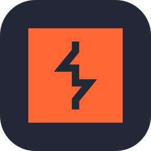
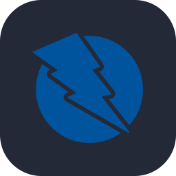
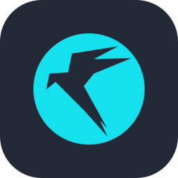
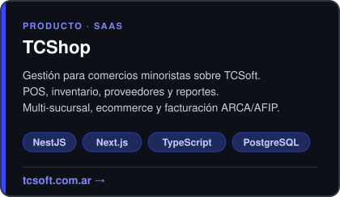
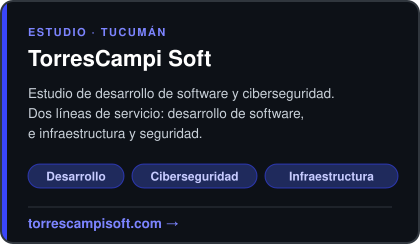

---

## Sobre mí

Construyo software y también me dedico a romperlo, para que no lo rompa otro.

- 🏢 **Fundador y CEO de <a href="https://torrescampisoft.com" target="_blank" rel="noopener noreferrer">TorresCampi Soft</a>**, estudio de desarrollo y ciberseguridad. Estoy construyendo **<a href="https://www.tcsoft.com.ar/" target="_blank" rel="noopener noreferrer">TCSoft</a>**, una plataforma SaaS donde corre **TCShop**, una solución para retail.
- 🛡️ **Especialista en ciberseguridad**: pentesting en entornos reales, capacitación técnica y divulgación en TV y radio.
- 💻 Backend desde 2016, full-stack desde 2024.
- 🔧 **Soporte IT, servidores y administración de sistemas**: reparo y configuro equipos desde 2005 (hardware y software), administro servidores y sistemas Windows y Linux y doy soporte cloud.
- ☁️ Preparando **AWS Certified Cloud Practitioner**.
- 🐍 Automatizo tareas de seguridad con Python.

## Stack

**Desarrollo**

  
  
  
  
  
  
  
  
  
  
  
  

**Seguridad y sistemas**

  
  
  
  
  
  
  
  
  

**Cloud**

  
  
  

**También trabajé con**

  
  
  
  
  
  

## Proyectos destacados

  
  

## TryHackMe

  
    
  
  

---

  <picture>
    <source media="(prefers-color-scheme: dark)" srcset="https://raw.githubusercontent.com/torrescampi/torrescampi/output/snake-dark.svg" />
    
  </picture>

